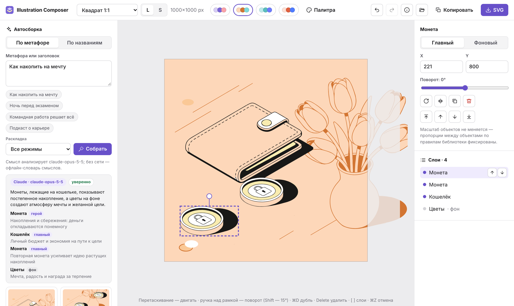
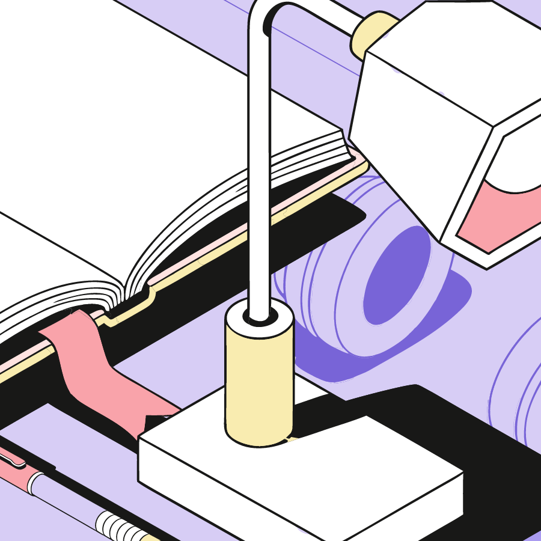
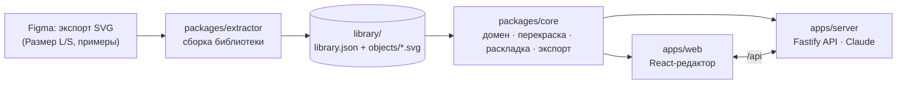

# Illustration Composer

Веб-сервис, который собирает векторные иллюстрации **только из объектов библиотеки** тестового задания
(10 объектов × главный/фоновый × размеры L/S, три цветовые схемы). Человек задаёт метафору/заголовок
или перечисляет объекты — сервис подбирает объекты, раскладывает их по правилам дизайнера, даёт
отредактировать, перекрасить загруженной палитрой и скачать редактируемый SVG.



**Демо (27 с):** метафора → Claude → варианты → перекраска схемами → правка → сценарий 2 → размер S → загрузка
палитры. [MP4](docs/demo.mp4) · GIF ниже.


## Что умеет — по пунктам задания

| Требование | Как сделано |
|---|---|
| Сценарий 1: метафора/заголовок → объекты в композиции | Claude (`claude-opus-5-5`) выбирает объекты по смыслу и объясняет выбор; без ключа — офлайн-анализ по словарю смыслов каталога. Затем авто-раскладка в 3 режимах (собранно / со смещением / под заголовок) — 4 варианта на выбор |
| Сценарий 2: названия компонентов → композиция | Разбор «телефон, 2 монеты, фоновая лампа»: падежи, синонимы, опечатки, количество, пометка «фоновый» |
| Сервис не генерирует новые объекты, объекты не меняются, вывод — вектор | Разметка объектов вставляется из библиотеки **побайтно** (меняются только значения цветовых атрибутов при перекраске и внешний `transform`); это проверяют тесты. У Claude id объектов — `enum` в схеме ответа: придумать объект он не может |
| Загружать/использовать подготовленную SVG-библиотеку | `library/` собрана автоматически из экспортов Figma (`npm run library:build`): 40 вариантов объектов, декор, схемы, 18 эталонных раскладок |
| Векторная структура, цвета, пропорции | Координаты путей не переписываются; все объекты в натуральном масштабе (как в эталонах дизайнера) — пропорции между объектами не меняются никогда |
| Добавлять на холст, двигать, вращать, дублировать, удалять | Клик или перетаскивание из библиотеки; drag на холсте; ручка поворота (Shift — шаг 15°), `R`; `⌘D`; `Delete`; `⌘Z/⇧⌘Z` |
| Порядок слоёв, сцена из нескольких иллюстраций | Панель слоёв, `[` `]`, «слои по глубине» (изометрический порядок); любые объекты в любых сочетаниях и количествах |
| Выбор размера и цветовой схемы | Размер **L/S** (S — упрощённые объекты и кадр вдвое меньше, раскладка сохраняется), форматы 1:1, 1200×630, 2:3, 16:9, свой; схемы Лаванда/Персик/Мята |
| Загрузка палитры и автоматическая перекраска | SVG-сетка палитры из Figma, JSON или список HEX → перекраска по ролям цветов (как на кадрах «SVG-drop»), с проверкой правил схемы и предпросмотром; палитры сохраняются на сервере |
| Экспорт SVG без растеризации, с редактируемостью | Скачать/скопировать SVG (вставляется в Figma как векторные группы «Телефон», «Монета_2», «Лампа_фон»…); в SVG встроены данные композиции — файл можно снова открыть в редакторе |

## Быстрый старт

Нужен Node.js ≥ 20.

```bash
npm install
npm start            # сборка интерфейса + сервер → http://127.0.0.1:8787
```

* Ключ Claude (необязательно) — в `.env` в корне: `ANTHROPIC_API_KEY=…` (шаблон — `.env.example`).
  Без ключа сценарий 1 работает на офлайн-анализе.
* Режим разработки: `npm run dev` (API на :8787 + Vite на http://localhost:5173).
* Автоматическая сборка из консоли:
  ```bash
  npm run compose --workspace @ic/server -- --text "Ночь перед экзаменом" --format square --scheme lavender --out ../../out/exam
  npm run compose --workspace @ic/server -- --mode names --text "телефон, фоновая лампа, 2 монеты" --size S
  ```
* Пересобрать библиотеку из новых экспортов Figma: положить SVG в `assets/figma-export/` и `npm run library:build`.
* Тесты: `npm test` (100 модульных и интеграционных), `npm run test:e2e` (10 сценариев Playwright в браузере).

## Примеры композиций

Собраны сервисом автоматически (Claude + авто-раскладка), без ручной правки. Рядом с каждым SVG лежит JSON
с разбором метафоры.

| «Как накопить на мечту» · 1200×630 · Персик | «Ночь перед экзаменом» · 1:1 · Лаванда |
|---|---|
|  |  |
| Монеты лежат на кошельке — накопления; цветы фоном — мечта ([SVG](examples/01-nakopit-na-mechtu.svg)) | Лампа над раскрытой книгой с ручкой, наушники фоном ([SVG](examples/02-noch-pered-ekzamenom.svg)) |

| «Командная работа решает всё» · 2:3 · Мята | Сценарий 2, размер S: «телефон, наушники, цветы на фоне» |
|---|---|
|  |  |
| Пазлы на папке проекта, лампа фоном ([SVG](examples/03-komandnaya-rabota.svg)) | Упрощённые S-объекты, кадр 500×500 ([SVG](examples/04-nazvaniya-razmer-s.svg)) |

## Архитектура



Монорепозиторий на TypeScript, «чистая архитектура»: **ядро** (`packages/core`) — чистые функции без I/O,
одинаково работают на сервере и в браузере; внешние зависимости — через порты (например,
`MetaphorAnalyzer` с адаптерами «Claude» и «офлайн»). Сервер и веб-клиент — тонкие слои над ядром.

```
assets/figma-export/   исходные экспорты Figma (источник истины)
library/               собранная библиотека: library.json, objects/{L,S}/*.svg, previews/
packages/core          типы, каталог, схемы, перекраска, импорт палитр, композиция, z-order,
                       рендер SVG, авто-раскладка, разбор текста, use-case composeFromText
packages/extractor     Figma SVG → библиотека (объекты, маски, декор, эталоны)
apps/server            API, адаптер Claude, хранилище палитр, CLI
apps/web               редактор (Zustand + SVG-холст), e2e-тесты
```

### Хранение SVG-элементов

`library/library.json` — единственный артефакт, который читают сервер и клиент:

* **объекты** — для каждого из 10 объектов × размер L/S × состояние главный/фоновый:
  `markup` — внутренняя разметка группы из Figma: пути **без изменений**, цвета приведены к `#RRGGBB`
  базовой схемы (Лаванда), служебные id Figma (`Vector_123`) удалены; `box` — визуальный габарит в
  исходных координатах кадра; `mask` — битовая маска силуэта (клетка 8 px, base64) для раскладки;
  `roles` — какие роли палитры использует объект;
* **схемы** — 3 схемы по 8 ролей: `bg1–bg3` (цвета фона), `ink` (контур), `obj1–obj3` (цвета объектов), `paper`;
* **декор** — элементы тайлов «Фон» (штрихи, конфетти, плоскость), привязанные к углам кадра;
* **эталоны** — 18 раскладок со страницы «Примеры композиций»;
* семантика каталога — названия, синонимы, смыслы, тип размещения (поверхность / плоский / объёмный).

Дополнительно каждый вариант лежит отдельным файлом `library/objects/{L,S}/<id>.<state>.svg` —
`viewBox` равен габариту объекта в исходных координатах, поэтому координаты путей не переписываются.

### Извлечение

`packages/extractor` разбирает экспорты Figma (`id` слоёв приходят «битым» UTF-8 — восстанавливаются):

1. объекты находятся по именам слоёв («Телефон», «Монета»…); безымянные группы (цветы, папка и ручка в S)
   распознаются по пропорциям относительно L;
2. главный/фоновый — по цветам (фоновый вариант двухтоновый: `bg1` + `bg3`);
3. габарит — по рендеру (resvg) с отбрасыванием «пылинок»: в исходной монете есть обрывок пути 0.5×1.3 px
   на 44 px ниже формы — он остаётся в разметке (объект не меняем), но не искажает центр;
4. декор — из тайлов «Фон»; эталоны раскладок — из примеров: каждый путь «голосует» за сдвиг
   относительно пути той же формы в библиотеке, поэтому распознаются даже объекты, обрезанные кадром.

Гарантии зафиксированы тестами: рендер вырезанного объекта пиксель-в-пиксель совпадает с исходной
группой Figma; `d` путей совпадают побайтно; все цвета — из базовой схемы; фоновые варианты следуют
правилу двух тонов (в «Наушниках» дизайнер сделал 1 исключение из 84 путей — тест это учитывает).

### Переиспользование

Композиция — это данные: кадр, размер L/S, схема, фон, декор и список элементов
`{objectId, state, x, y, rotation}` (координаты — центр объекта в единицах L). SVG собирается вставкой
разметки объекта из библиотеки внутрь `<g transform="translate·rotate">`; размер S использует ту же
раскладку и упрощённые объекты в кадре вдвое меньше. Перекраска — замена каждого цвета базовой схемы
цветом той же роли в целевой схеме (проверено: так перекрашены кадры «SVG-drop» в Figma).
Экспорт кладёт в `<metadata>` JSON композиции — файл снова открывается в редакторе для правки.

### Авто-раскладка

Объекты нельзя масштабировать, поэтому раскладка — это поиск позиций в кадре. Функция качества
формализует правила из вкладок Figma и 18 эталонов: герой виден целиком, второстепенные — почти целиком,
фоновые крупные и частично за краем, позади и выше главных; главные не перекрывают друг друга, кроме
«плоский предмет лежит на поверхности» (телефон на книге, пазлы на папке); баланс; без «касаний» краёв;
в режиме «Под заголовок» свободна зона заголовка. Поиск — отжиг из нескольких стартов: раскладки
эталонов, «роли» эталонов, эвристики. Если крупные объекты не помещаются, движок переводит контекстный
объект в фоновое состояние (как делает дизайнер). Эталоны дизайнера проходят эту оценку как хорошие —
это откалибровано тестом; вариант раскладки считается за ~50–250 мс.

### Понимание текста

* **Сценарий 1.** Адаптер Claude отправляет каталог (смыслы, реальные размеры объектов, формат кадра) и
  получает структурированный JSON (`output_config.format`); id объектов — перечисление из библиотеки.
  Включены `effort: low`, кэш ответов, таймаут и серверный фолбэк при отказе модели. Любая ошибка →
  офлайн-анализ (стемминг русского, смыслы каталога, естественные пары объектов), источник виден в UI.
* **Сценарий 2.** Парсер названий: морфология, синонимы (рус./англ.), опечатки (Дамерау — Левенштейн),
  «2 монеты», «фоновая лампа», «наушники на фоне»; неизвестные слова перечисляются пользователю.

### Палитры

Палитра = 8 ролей в порядке сетки Figma (левый столбец — фон и контур, правый — объекты и белый).
Принимаются SVG-экспорт сетки из Figma, JSON (`{"background":[3], "objects":[3]}` или роли) и список
из 6/8 HEX. Правило библиотеки «цвета объектов нельзя использовать в фоне» проверяется: палитра,
где цвет объекта совпадает с цветом фона, отклоняется с объяснением.

## Найденное при анализе Figma

* Все 18 эталонных композиций используют объекты в масштабе 1:1 — кадр только обрезает сцену.
* Кадры «SVG-drop» на странице библиотеки — антипример: объекты в них разного масштаба (лампа ×0.15,
  ручка ×0.34), что нарушает правило пропорций. Сервис такого не допускает.
* Цвета перекраски в «SVG-drop» совпадают с ролевой заменой — это подтвердило модель палитры.

## Тесты

* `npm test` — 100 тестов (Vitest): палитры и импорт, экстрактор на реальных экспортах Figma
  (побайтная и пиксельная идентичность), модель композиции и экспорт, авто-раскладка (инварианты на
  4 форматах, эталоны, детерминизм, скорость), разбор текста, API (Fastify inject), адаптер Claude.
* `npm run test:e2e` — 10 сценариев в Chromium: оба сценария автосборки, ошибки ввода, редактирование
  и undo, drag & drop из библиотеки, перекраска схемой и загруженной палитрой, скачивание SVG и его
  повторное открытие (с отбрасыванием чужих объектов).

## AI-инструменты

* **Claude Code (Claude Opus 5.5)** — анализ макета Figma через браузер, проектирование, код, тесты,
  визуальная проверка раскладок.
* **Claude API, модель `claude-opus-5-5`** — в работе сервиса: смысловой анализ метафоры (сценарий 1).
  Новые изображения или объекты ИИ не создаёт.

## Ограничения и развитие

* Плагин для Figma: ядро изоморфно и без зависимостей — его можно встроить в плагин и собирать
  композиции прямо из компонентов файла.
* Импорт новой библиотеки сейчас — командой `npm run library:build`; можно добавить загрузку экспорта
  Figma через интерфейс.
* Публичный деплой не делался: запуск локально одной командой `npm start`.

## Деплой

Публичное демо: https://illustration-composer-eta.vercel.app (Vercel). `scripts/vercel-build.mjs` собирает результат по Build Output API: фронтенд уходит статикой, API собирается esbuild в одну Node-функцию, рядом с ней лежит `library.json`. Ключ `ANTHROPIC_API_KEY` хранится в переменных окружения Vercel, в репозитории его нет. Обращения к модели ограничены (`LLM_RATE_LIMIT` за `LLM_RATE_WINDOW_MS`), сверх лимита сервис переключается на офлайн-анализ. Загруженные палитры на serverless хранятся во временном каталоге инстанса и могут сброситься. Для постоянного хранения есть `render.yaml`: обычный Node-сервер на Render.
